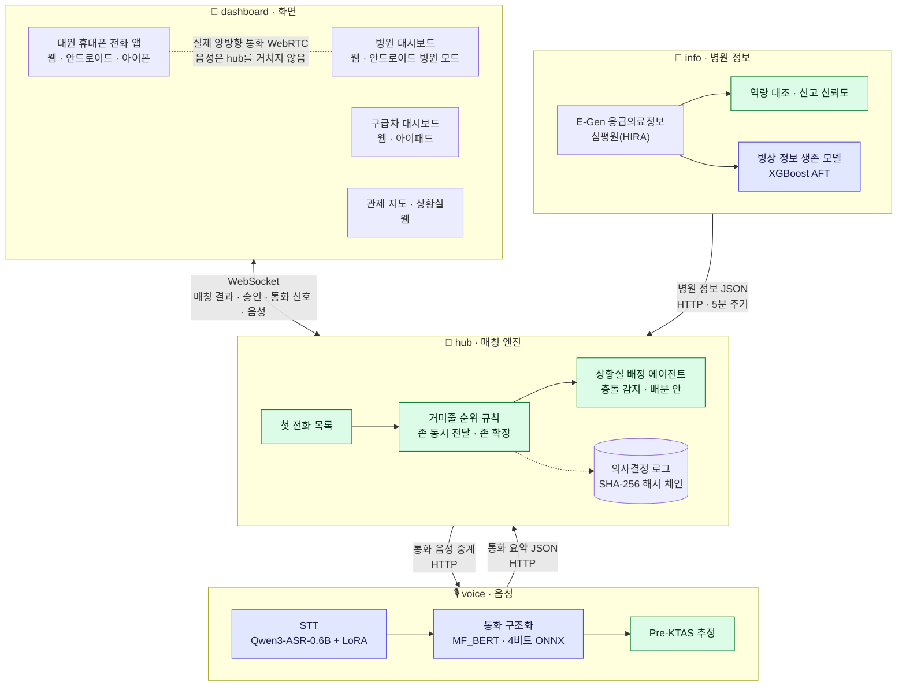

<div align="center">

# 🚑 골든링크 GoldenLink

**응급 이송 골든타임 단축을 위한 실시간 병원 매칭 시스템**

🏅 **2026 AI ROOKIE 1차 결선 진출작** 🏅


</div>

> 📞 **첫 병원과의 통화를 바로 구조화해, 반경(존) 안 후보 병원 전체에 동시에 전달합니다.**
> 구급대원이 따로 입력하지 않아도 통화와 병원 응답이 그대로 기록이 되는 **Zero Data Entry** 응급이송 지원 플랫폼입니다.

📖 코드·실행 방법은 [develop README](https://github.com/podongchip-stack/AIRookie/blob/develop/README.md) ·
설계 원칙·데이터 포맷은 [CLAUDE.md](https://github.com/podongchip-stack/AIRookie/blob/develop/CLAUDE.md)
(`main`은 공통 문서만 보관합니다)

---

## 💡 한눈에 보기

| 😰 문제 | 📡 해결 | 🧑‍⚕️ 원칙 |
|---|---|---|
| 받아 줄 병원을 찾으려 차례로 전화하는 동안 골든타임이 흐른다 | 첫 통화를 텍스트로 옮겨 구조화하고 존 안 병원 전체에 **동시 전달** | AI는 정리만, **판단은 사람과 규칙** |

---

## 🧭 설계 원칙

- 🤖 **AI는 판단하지 않습니다** — 음성 인식·통화 구조화·병상 정보 신뢰도에만 쓰고, 순위와 배정은 규칙, 결정은 사람이 합니다
- 🚫 **생성형 LLM 없음** — 구조화도 선택지에서 고르는 분류 모델이라 출력 형식이 깨지지 않습니다
- ✍️ **구급대원이 확인·수정** — 고친 칸은 "AI 값 → 구급대원 값"으로 병원 화면과 기록에 남습니다
- 🏷️ **출처 표시** — 모든 결과에 `source: "ai" | "rule"`, 병원 후보마다 순위 근거를 보여 줍니다
- 🙅 **후보에서 빼지 않음** — 정보가 없는 병원은 제외하지 않고 뒤로 둡니다
- 🔒 **환자 정보는 밖으로 안 나감** — On-Premise · 온디바이스 지원 · 의사결정 기록은 SHA-256 해시 체인

---

## 🔄 이송 흐름

| | 단계 | 무엇이 일어나나 |
|:-:|---|---|
| 🚨 | **출동** | 통화 전 "첫 전화 목록"을 규칙으로 계산 (이동 시간·병상·전문의·다른 구급차 연락 상황) |
| 📞 | **첫 통화** | 휴대폰으로 병원과 통화, 발화 단위로 인식해 실시간 자막 |
| 🧠 | **구조화** | 환자 수·성별·나이대·주증상·의식·활력징후·처치, 통화 결과(수용·거절·보류) 추출 |
| ✅ | **첫 통화 판단** | 받으면 그 병원으로 **이송확정**, 아니면 **이송불가** → 존 전체에 동시 전달 |
| 🏥 | **병원 회신** | 수용 승인·불가. 수용 병원이 없으면 존을 넓힘. 구급대원은 요약을 확인·수정 |
| 🚑 | **이송 승인** | 구급대원이 확정. 여러 사건이 한 병원에 몰리면 상황실이 지정 |
| 💓 | **이송 중** | 활력징후 악화를 병원에 알리고 필요하면 대체 병원 제안 |
| 🏁 | **도착** | 수용 완료·도착 후 수용 불가 기록 |

---

## 🏗️ 시스템 구조



🟪 **AI 처리** · 🟩 **규칙 기반** — 대시보드와 앱은 `hub`와만 통신합니다. 휴대폰 앱은 STT·구조화를 기기 안에서 돌릴 수도 있습니다.

---

## ⚖️ AI와 규칙의 자리

| 하는 일 | 방식 | 쓰는 것 |
|---|:-:|---|
| 🎙️ 음성 → 텍스트 | 🤖 AI | Qwen3-ASR-0.6B + LoRA (119 신고 음성으로 파인튜닝) |
| 📝 통화 구조화 · 결과 판정 | 🤖 AI | MF_BERT (KLUE RoBERTa-large + 결정 디코더, 4비트 ONNX) |
| 📊 병상 정보 신뢰도 | 🤖 AI | XGBoost AFT 생존모델 — 순위엔 안 쓰고 설명용 |
| 🩺 진료과 매칭 | 🤖 AI 보조 | 경량 임베딩 유사도 (점수 노출) |
| 🚦 Pre-KTAS 추정 | 📏 규칙 | 공개 기준(OTAS·Pre-KTAS) 대입 — 공식 판정 아님 |
| 🕸️ 병원 순위 | 📏 규칙 | 거미줄 규칙 — 이동 시간을 역량·부하로 보정 |
| 🗺️ 존 확장 · 상황실 배정 | 📏 규칙 | 거절 비율·대기 시간, 쏠림 감지 — 결정은 사람 |
| 💓 이송 중 판정 | 📏 규칙 | NEWS2 + 쇼크지수 |

---

## 📦 구성 요소

| 폴더 | 내용 |
|---|---|
| 🎙️ [`voice/`](https://github.com/podongchip-stack/AIRookie/blob/develop/voice/README.md) | 중앙 음성 서버 — STT · 통화 구조화 · Pre-KTAS |
| 🏥 [`info/`](https://github.com/podongchip-stack/AIRookie/blob/develop/info/README.md) | 병원 정보 수집 · 역량 대조 · 병상 정보 생존 모델 |
| 🧩 [`hub/`](https://github.com/podongchip-stack/AIRookie/blob/develop/hub/README.md) | 매칭 엔진 · 순위 · 상황실 배정 · WebSocket 서버 |
| 📱 [`dashboard/`](https://github.com/podongchip-stack/AIRookie/blob/develop/dashboard/README.md) | 웹 대시보드 + 안드로이드 · 아이폰 · 아이패드 앱 |
| 🕸️ [`spider/`](https://github.com/podongchip-stack/AIRookie/blob/develop/spider/README.md) | 거미줄 분배 모델 + 3D 화면 (hub 순위 규칙의 원본) |
| 🔥 [`sim/`](https://github.com/podongchip-stack/AIRookie/blob/develop/sim/README.md) | 대량사고 이송 시뮬레이션 (메커니즘 데모) |
| 🧪 [`poc/`](https://github.com/podongchip-stack/AIRookie/blob/develop/poc/README.md) | 현장 실증 설계 |
| 📞 [`turn/`](https://github.com/podongchip-stack/AIRookie/blob/develop/turn/README.md) | 실제 통화용 TURN 서버 설정 |

### 🖥️ 화면

| 화면 | 사용자 | 하는 일 |
|---|---|---|
| 📞 휴대폰 전화 앱 · 웹·안드로이드·아이폰 | 구급대원 | 병원을 골라 통화 → 이송확정 / 이송불가 |
| 🚑 구급차 대시보드 · 웹·아이패드 | 구급대원 | 요약 확인·수정, 후보 병원, 이송 승인 |
| 🏥 병원 대시보드 · 웹·안드로이드 | 병원 | 수용 승인·불가, 도착 결과, 실제 통화 수신 |
| 🗺️ 관제 지도 | 상황실 | 전체 현황, 배정 충돌 알림·병원 지정 |
| 🕸️ 3D 거미줄 | 관제·발표 | 사건과 병원 후보를 3차원으로 |

---

## 🛠️ 기술 스택

| 영역 | 기술 |
|---|---|
| 🐍 서버 | Python 3.11 · Flask · flask-sock · pydantic |
| 🎙️ 음성 AI | PyTorch · transformers · peft · onnxruntime |
| 📊 데이터 | E-Gen API · 심평원 API · XGBoost · Supabase · 카카오모빌리티 길찾기 |
| 🌐 웹 | Next.js 16 · React 19 · TypeScript · Panda CSS · 카카오맵 |
| 📱 앱 | Kotlin · Jetpack Compose · SwiftUI · onnxruntime-android |
| 🕸️ 3D · 📞 통화 | deck.gl · MapLibre · WebRTC · coturn |

---

## 🚧 아직 검증 중

- 동시 전달이 현장 이송 시간을 얼마나 줄이는지는 아직 측정 전 — 실증 설계는 `poc/`
- 순위 가중치·이송 중 판정 기준은 전문의 검토 전 초안, Pre-KTAS 추정은 실제 KTAS로 검증 전
- 구급차 위치·이동은 시연용 시뮬레이션, 접속은 접근 코드로만 구분
- 실제 양방향 통화와 AI 통화 결과 판정은 실기기·실제 통화로 확인 중

---

## 👥 팀 구성

<table>
  <tr>
    <td align="center" width="170">
      <a href="https://github.com/dltmdwn0147">
        <br>
        <b>이승주</b>
      </a><br>
      <sub>PM · AI 개발자</sub>
    </td>
    <td align="center" width="170">
      <a href="https://github.com/Playedwell03">
        <br>
        <b>곽호영</b>
      </a><br>
      <sub>AI 개발자</sub>
    </td>
    <td align="center" width="170">
      <a href="https://github.com/taewoo01">
        <br>
        <b>김태우</b>
      </a><br>
      <sub>AI 개발자</sub>
    </td>
    <td align="center" width="170">
      <a href="https://github.com/junniec01-creator">
        <br>
        <b>최준혁</b>
      </a><br>
      <sub>AI 개발자</sub>
    </td>
    <td align="center" width="170">
      <a href="https://github.com/podongchip-stack">
        <br>
        <b>김동현</b>
      </a><br>
      <sub>AI 개발자</sub>
    </td>
  </tr>
</table>

---

## 🤝 개발 · 협업

### ▶️ 실행해 보기

```bash
git clone https://github.com/podongchip-stack/AIRookie.git && cd AIRookie
git checkout develop
./start-all.sh --local    # 터미널 1 — hub · info · dashboard · spider 등
./voice/start-voice.sh    # 터미널 2 — 중앙 음성 서버
```

처음이면 [develop README](https://github.com/podongchip-stack/AIRookie/blob/develop/README.md)의 가상환경·API 키 준비부터. Windows는 Git Bash에서 실행합니다.

### 🌿 브랜치

```
feature/*  →  develop  →  main
```

| 브랜치 | 역할 | 직접 Push |
|---|---|:-:|
| `main` | 배포 기준 (현재는 공통 문서만) | ❌ |
| `develop` | 통합 — 모든 코드 | ❌ |
| `feature/voice` · `info` · `hub` · `dashboard` | 각 폴더 담당 | ✅ |
| `feature/sim` · `spider` | 시뮬레이션 · 거미줄 모델 | ✅ |
| `demo` | 시연 영상 · 자동 시연 전용 | ⚠️ |

> ⚠️ **`demo` → `develop`/`main` 병합·체리픽 금지** (2026-10-03 팀 규칙). `develop` → `demo` 방향만 허용합니다.
> GitHub 설정으로 막혀 있지 않으니 직접 지켜야 합니다.

### ✍️ 커밋 · PR

- 커밋: `타입: 요약` — `feat` 기능 · `fix` 버그 · `docs` 문서 · `refactor` 리팩토링 · `chore` 기타
- PR: `feature/* → develop`은 누구나 머지, `develop → main`은 PM 승인 후
- 최신화: `./pull-all.sh`로 `main` · `develop` · feature 4개를 한 번에
