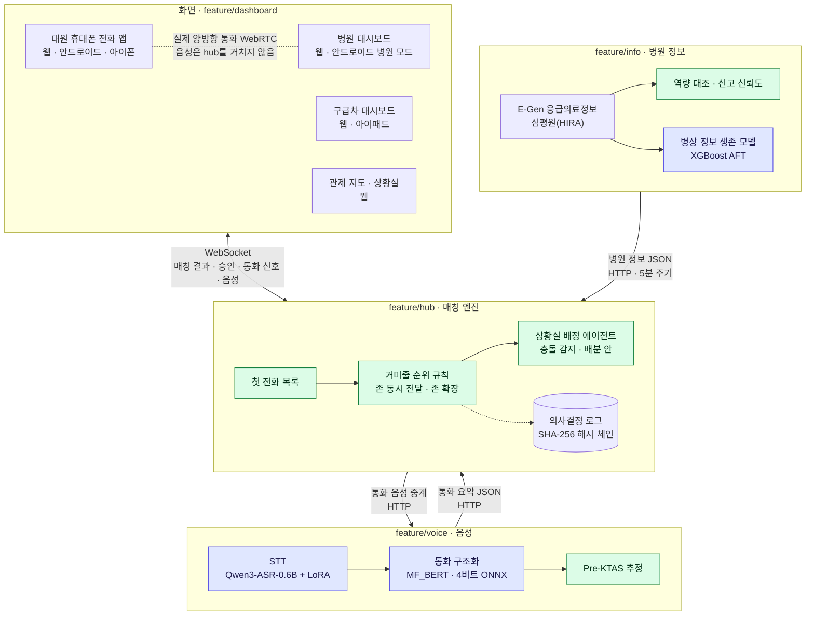

# 골든링크 (GoldenLink) — 응급 이송 골든타임 단축을 위한 실시간 병원 매칭 시스템

> 🏅 **2026 AI ROOKIE 1차 결선 진출작**

구급대원이 환자를 받아 줄 병원을 찾느라 여러 병원에 차례로 전화를 거는 동안 골든타임이
흘러갑니다. 골든링크는 **첫 병원과의 통화를 그 자리에서 텍스트로 옮기고 구조화해, 반경(존) 안의
후보 병원 전체에 동시에 전달**합니다. 병원들은 같은 요약을 보고 수용 여부를 회신하고, 구급대원은
수용한 병원 가운데 이송 병원을 고릅니다. 그 사이의 모든 판단은 위변조를 검증할 수 있는 로그로
남습니다.

구급대원이 따로 입력하지 않아도 통화와 병원 응답이 그대로 기록이 되는 **Zero Data Entry 기반
응급이송 지원 플랫폼**입니다.

| 보고 싶은 것 | 문서 |
|---|---|
| 실행 방법 · 전체 코드 | [develop 브랜치 README](https://github.com/podongchip-stack/AIRookie/blob/develop/README.md) |
| 설계 원칙 · 서비스 간 데이터 포맷 | [CLAUDE.md (develop)](https://github.com/podongchip-stack/AIRookie/blob/develop/CLAUDE.md) |
| 구성 요소별 상세 | 아래 [구성 요소](#구성-요소) 표의 폴더별 문서 |

> `main` 브랜치는 공통 문서만 보관합니다. 코드는 모두 `develop`에 있습니다.

---

## 설계 원칙

- **AI는 판단하지 않습니다.** AI는 음성 인식, 통화 내용 구조화, 병상 정보 신뢰도 예측처럼
  사람의 손을 덜고 보이지 않는 것을 재는 자리에만 둡니다. 병원 순위 · 존 확장 · 상황실 배정은
  규칙 기반이고, 수용과 이송 결정은 병원과 구급대원이 합니다.
- **생성형 LLM을 쓰지 않습니다.** 통화 구조화도 정해진 선택지에서 고르는 분류 · 태깅 모델이라
  출력 형식이 깨지지 않습니다.
- **AI 요약은 구급대원이 확인 · 수정합니다(Override).** 요약은 통화가 끝나면
  "AI 요약 · 구급대원 확인 전"으로 먼저 전달되고, 구급대원이 고친 칸은
  "AI 값 → 구급대원 값"으로 병원 화면과 기록에 남습니다.
- **출처를 숨기지 않습니다.** 모든 결과에 `source: "ai" | "rule"`이 붙고, 병원 후보 카드마다
  왜 이 순위인지 근거가 적힙니다.
- **후보에서 빼지 않습니다.** 병상 수를 모르거나 역량 정보가 없는 병원은 제외하지 않고 뒤로
  둡니다. 잘못 걸러내는 쪽이 순차 전화를 더 만들기 때문입니다.
- **환자 정보는 밖으로 나가지 않습니다.** On-Premise로 운영하고 통화 음성 · 내용을 외부 상용
  API로 보내지 않습니다. 휴대폰 앱은 STT · 구조화를 기기 안에서 돌릴 수도 있습니다. 이름 ·
  주민등록번호 · 주소는 처리 대상이 아닙니다.
- **기록은 고칠 수 없게 남깁니다.** 모든 의사결정은 타임스탬프 + SHA-256 해시 체인으로 저장하고,
  통화 전문은 지문(해시)으로 바꿔 남깁니다.

---

## 이송 흐름

1. **출동** — 구급차가 현장으로 가는 동안 hub가 통화 전 "첫 전화 목록"을 만듭니다. 이동 시간,
   다른 구급차가 이미 연락 중이거나 향하고 있는 병원, 응급의학과 전문의 · 병상, 병상 숫자가 도착
   때까지 맞을 확률을 합친 규칙 순위입니다.
2. **첫 통화** — 대원 휴대폰 앱에서 병원을 골라 통화합니다. 말이 끊길 때마다 발화 단위로 인식해
   자막을 띄워 두므로, 통화가 끝나면 마지막 발화 인식과 구조화만 남습니다.
3. **구조화** — 환자 수와 환자별 성별 · 나이대 · 주증상 · 의식 상태 · 활력징후 · 처치를 뽑고,
   통화 결과(수용 · 거절 · 보류)를 판정합니다. Pre-KTAS 단계는 규칙으로 추정합니다(공식 판정이
   아닙니다).
4. **첫 통화 판단** — 통화한 병원이 받았으면 **[이송확정]**으로 그 병원에만 요약을 보내고 바로
   출발합니다. 받지 못했으면 **[이송불가]**로 요약을 **존 안 후보 병원 전체에 동시에** 보냅니다.
   AI 통화 판정이 수용이나 거절이면 hub가 대신 고르고, 보류이거나 판정이 없으면 구급대원이
   고릅니다. 구급대원이 먼저 고르면 그 판단이 우선합니다.
5. **병원 회신 · 확인** — 병원은 같은 요약을 보고 수용 승인 또는 불가(사유)를 누릅니다. 수용
   병원이 나오지 않으면 거절 비율과 대기 시간에 따라 존을 넓힙니다. 구급대원은 그동안 요약을
   확인하거나 고칠 수 있고, 순위에 쓰이는 칸을 고치면 다시 매칭합니다.
6. **이송 승인** — 구급대원이 수용한 병원 가운데 하나를 확정합니다. 선택되지 않은 병원에는 바로
   통보가 갑니다. 여러 사건이 같은 병원으로 몰리면 상황실 배정 에이전트가 충돌을 알리고 배분 안을
   제안하며, 결정은 상황실이 합니다.
7. **이송 중** — 활력징후 변화를 공개 기준(NEWS2 · 쇼크지수)으로 판정해 확정 병원에 알리고,
   필요하면 대체 병원 후보를 제안합니다. 추가 통화 내용은 기존 환자 정보에 덧붙습니다.
8. **도착** — 병원이 수용 완료 또는 도착 후 수용 불가를 기록합니다. 수용 불가면 그 자리에서
   다시 고릅니다.

---

## 시스템 구조

서비스마다 따로 실행되고 HTTP · WebSocket으로 통신합니다. 대시보드와 앱은 `hub`와만 통신하고
(3D 거미줄 화면은 `spider` 서버가 hub 데이터를 받아 그립니다), 음성 요약과 병원 정보는 모두 hub를
거쳐 전달됩니다.



> 보라색 = **AI 처리**, 초록색 = **규칙 기반**. 휴대폰 앱을 온디바이스 모드로 쓰면 STT · 구조화를
> 기기 안에서 돌리고 hub에는 요약만 보냅니다. 상황실 배정 에이전트는 이름과 달리 규칙 기반입니다.

---

## AI와 규칙의 자리

| 하는 일 | 방식 | 쓰는 것 |
|---|---|---|
| 음성 → 텍스트 | AI | Qwen3-ASR-0.6B + LoRA(119 신고 음성으로 파인튜닝). 통화 중 발화 단위로 인식 |
| 통화 내용 구조화 | AI + 규칙 | MF_BERT(KLUE RoBERTa-large + 결정 디코더, 4비트 ONNX). 선택지에서 고르는 분류 · 태깅이고, 활력징후 숫자는 모델이 찾은 구간을 규칙으로 읽습니다 |
| 통화 결과 판정 | AI | MF_BERT 통화 결과 디코더(수용 · 거절 · 보류). 수용 · 거절이면 첫 통화 판단을 대신 고르고, 보류면 구급대원에게 넘깁니다 |
| Pre-KTAS 추정 | 규칙 | 주증상 · 의식 · 활력징후를 공개 기준(OTAS · Pre-KTAS · Pre-CTAS)에 대입. 공식 판정이 아닌 추정값 |
| 병상 정보 신뢰도 | AI | XGBoost AFT 생존모델 — 지금 보이는 병상 숫자가 도착 때까지 유지될 확률. 순위 계산에는 쓰지 않고 설명 · 첫 전화 목록 · 위험 등급에 씁니다 |
| 진료과 매칭 | AI 보조 | 경량 임베딩 유사도(sentence-transformers). 유사도 점수를 화면에 보여 줍니다 |
| 병원 순위 | 규칙 | 거미줄 규칙 — 도로 이동 시간에서 환자에게 필요한 역량을 넘는 만큼 당기고, 모자란 만큼과 병원 부하만큼 미룹니다. 질환군별 필수 조건(혈관조영 · CT 운영 등)과 병원의 수용 제한 공지를 반영합니다 |
| 병원 역량 · 신고 신뢰도 | 규칙 | E-Gen 중증질환 신고를 심평원 전문의 수 · 전문병원 지정과 대조해 근거 강도를 매깁니다 |
| 존 확장 · 상황실 배정 | 규칙 | 거절 비율 · 대기 시간 기반 확장, 여러 사건의 쏠림 감지와 배분 안. 결정은 사람 |
| 이송 중 상태 변화 | 규칙 | NEWS2 + 쇼크지수 |
| 의사결정 기록 | 규칙 | 타임스탬프 + SHA-256 해시 체인 |

---

## 구성 요소

여러 브랜치가 하나의 작업 폴더를 나눠 쓰는 모노레포입니다. 각 브랜치가 자기 폴더를 맡고,
`develop`이 전부를 합쳐 실제로 통신이 되는 상태를 유지합니다.

| 폴더 | 브랜치 | 내용 | 문서 |
|---|---|---|---|
| `voice/` | `feature/voice` | 중앙 음성 서버 — 발화 단위 STT, 통화 구조화, Pre-KTAS 추정 | [voice/README.md](https://github.com/podongchip-stack/AIRookie/blob/develop/voice/README.md) |
| `info/` | `feature/info` | E-Gen · 심평원 병원 정보 수집 · 정규화, 역량 대조, 병상 정보 생존 모델, 거절 로그 수신, 서울 119안전센터 구급차 레지스트리 | [info/README.md](https://github.com/podongchip-stack/AIRookie/blob/develop/info/README.md) |
| `hub/` | `feature/hub` | 첫 전화 목록 · 거미줄 순위 · 존 동시 전달, 승인 흐름, 상황실 배정, 이송 중 판정, 통화 신호 중계, 의사결정 로그, HTTP/WebSocket 서버 | [hub/README.md](https://github.com/podongchip-stack/AIRookie/blob/develop/hub/README.md) |
| `dashboard/` | `feature/dashboard` | 웹 대시보드(Next.js)와 안드로이드 · 아이폰 · 아이패드 앱 | [dashboard/README.md](https://github.com/podongchip-stack/AIRookie/blob/develop/dashboard/README.md) |
| `spider/` | `feature/spider` | 거미줄 분배 모델 실험실 + 3D 거미줄 화면 서버(hub 순위 규칙의 원본) | [spider/README.md](https://github.com/podongchip-stack/AIRookie/blob/develop/spider/README.md) |
| `sim/` | `feature/sim` | 대량사고(MCI) 분산 이송 시뮬레이션 — 사건 재현이 아닌 메커니즘 데모 | [sim/README.md](https://github.com/podongchip-stack/AIRookie/blob/develop/sim/README.md) |
| `poc/` | `develop` | 현장 실증 설계와 근거 자료 | [poc/README.md](https://github.com/podongchip-stack/AIRookie/blob/develop/poc/README.md) |
| `supabase/` | `develop` | E-Gen 스냅샷 클라우드 수집(Edge Function · cron) | — |
| `turn/` | `develop` | 실제 양방향 통화용 TURN 서버(coturn) 설정 | [turn/README.md](https://github.com/podongchip-stack/AIRookie/blob/develop/turn/README.md) |

### 화면

| 화면 | 쓰는 사람 | 하는 일 |
|---|---|---|
| 대원 휴대폰 전화 앱 — 웹 `/phone` · 안드로이드 · 아이폰 | 구급대원 | 첫 전화 목록에서 병원을 골라 통화하고 [이송확정]/[이송불가]를 고릅니다. 앱은 온디바이스 STT · 구조화와 실제 양방향 통화를 지원합니다 |
| 구급차 대시보드 — 웹 `/ambulance` · 아이패드 | 구급대원 | 통화 요약 확인 · 수정, 병원 후보(순위 근거 · 배후역량), 이송 승인. 아이패드는 외상 부위 도해 · 인계확인서 · 3D 거미줄을 함께 보여 줍니다 |
| 병원 대시보드 — 웹 `/hospital` · 안드로이드 병원 모드 | 병원 | 수용 요청 확인, 수용 승인 · 불가(사유), 도착 결과 기록, 우리 병원 정보 확인. 안드로이드 병원 모드는 실제 통화를 받습니다 |
| 관제 지도 — 웹 `/map` | 상황실 | 전체 병원 · 구급차 · 사건 진행, 배정 충돌 알림과 상황실 지정, 다수 사상자 신고 |
| 신뢰도 검증 — 웹 `/verify` | 누구나 | 병상 정보 생존 모델의 예측을 실제 E-Gen 다음 값으로 채점합니다(시연용 예시) |
| 3D 거미줄 — `spider/` 서버 | 관제 · 발표 | 진행 중인 사건과 병원 후보를 3차원 거미줄로 그립니다 |

---

## 기술 스택

| 영역 | 사용 기술 |
|------|-----------|
| 공통 | Python 3.11, Flask, pydantic 2.x(서비스 간 JSON 스키마 계약) |
| 음성 (`voice/`) | PyTorch · transformers(Qwen3-ASR) · peft(LoRA), onnxruntime(MF_BERT 4비트 ONNX). 가중치는 Hugging Face Hub에서 고정 커밋으로 받습니다 |
| 매칭 (`hub/`) | Flask + flask-sock(순수 WebSocket), sentence-transformers(진료과 임베딩), 카카오모빌리티 길찾기 API(도로 이동 시간) |
| 병원 정보 (`info/`) | E-Gen 응급의료정보 API(목록 · 실시간 가용병상 · 중증질환 수용가능 · 수용 제한 메시지), 심평원(HIRA) API 3종, XGBoost(AFT 생존모델), Supabase(구급차 레지스트리 · E-Gen 스냅샷 수집) |
| 웹 대시보드 (`dashboard/`) | Next.js 16(App Router) · React 19 · TypeScript · Panda CSS, 카카오맵 JS SDK |
| 모바일 앱 (`dashboard/android` · `iphone` · `ipad`) | 안드로이드 Kotlin · Jetpack Compose · onnxruntime-android · 카카오맵 SDK, iOS · iPadOS SwiftUI |
| 3D 거미줄 (`spider/`) | Python(numpy · scipy) 엔진 + deck.gl · MapLibre |
| 통화 | WebRTC(hub는 연결 협상만 중계, 음성은 단말끼리), coturn |
| 실행 환경 | On-Premise(로컬 GPU) — 외부 상용 LLM API로 환자 데이터를 내보내지 않습니다 |

---

## 아직 검증 중인 것

- 동시 전달이 실제 현장에서 이송 시간을 얼마나 줄이는지는 아직 측정하지 않았습니다. 실증 설계는
  [`poc/`](https://github.com/podongchip-stack/AIRookie/blob/develop/poc/README.md)에 있습니다.
- 순위 규칙의 가중치와 이송 중 판정 기준은 전문의 검토 전 초안이고, Pre-KTAS 추정은 실제 KTAS로
  검증하기 전입니다.
- AI 통화 결과 판정은 병원 응답이 통화에 담기지 않으면 수용 쪽으로 기우는 약점이 있어, 실제 통화로
  확인하는 중입니다.
- 구급차 위치 · 이동은 시연용 시뮬레이션입니다(실제 구급차 GPS 수신 경로는 아직 없습니다).
- 접속은 접근 코드로만 구분합니다(시연 범위, 별도 인증 없음).
- 휴대폰 앱의 실제 양방향 통화(WebRTC)는 실기기 검증을 진행 중입니다.

---

## 팀 구성

<table>
  <tr>
    <td align="center" width="170">
      <a href="https://github.com/dltmdwn0147">
        <br>
        <b>이승주</b>
      </a><br>
      <sub>PM · AI 개발자</sub>
    </td>
    <td align="center" width="170">
      <a href="https://github.com/Playedwell03">
        <br>
        <b>곽호영</b>
      </a><br>
      <sub>AI 개발자</sub>
    </td>
    <td align="center" width="170">
      <a href="https://github.com/taewoo01">
        <br>
        <b>김태우</b>
      </a><br>
      <sub>AI 개발자</sub>
    </td>
    <td align="center" width="170">
      <a href="https://github.com/junniec01-creator">
        <br>
        <b>최준혁</b>
      </a><br>
      <sub>AI 개발자</sub>
    </td>
    <td align="center" width="170">
      <a href="https://github.com/podongchip-stack">
        <br>
        <b>김동현</b>
      </a><br>
      <sub>AI 개발자</sub>
    </td>
  </tr>
</table>

---

## 개발 · 협업

### 실행해 보기

코드는 `develop`에 있습니다. 처음이면 [develop README](https://github.com/podongchip-stack/AIRookie/blob/develop/README.md)의
"가상환경 준비 · API 키 준비"를 먼저 끝냅니다.

```bash
git clone https://github.com/podongchip-stack/AIRookie.git
cd AIRookie
git checkout develop

./start-all.sh --local    # 터미널 1 — hub · info · dashboard · spider 서버 등 (로컬 주소)
./voice/start-voice.sh    # 터미널 2 — 중앙 음성 서버(STT · 구조화)
```

Windows는 Git Bash에서 실행합니다. 옵션 · 접근 코드 · 시연 순서는 develop README에 있습니다.

### 브랜치 전략

| 브랜치 | 역할 | 직접 Push |
|--------|------|-----------|
| `main` | 배포 기준 브랜치(현재는 공통 문서만 보관) | 금지 |
| `develop` | 통합 브랜치 — 모든 코드가 합쳐진 상태 | 금지 |
| `feature/voice` | 음성 STT · 통화 구조화 · Pre-KTAS 추정 | 가능 |
| `feature/info` | 병원 정보(E-Gen · 심평원) 수집 · 역량 대조 · 병상 정보 생존 모델 | 가능 |
| `feature/hub` | 매칭 엔진 · 순위 규칙 · 상황실 배정 · HTTP/WebSocket 서버 | 가능 |
| `feature/dashboard` | 웹 대시보드 · 안드로이드 · 아이폰 · 아이패드 앱 | 가능 |
| `feature/sim` | 대량사고 분산 이송 시뮬레이션 | 가능 |
| `feature/spider` | 거미줄 분배 모델 · 3D 화면 | 가능 |
| `demo` | 시연 영상 · 자동 시연 전용 | 아래 주의 |

```
feature/*  →  develop  →  (배포 준비 완료 시)  →  main
```

> ⚠️ **`demo` 브랜치의 작업은 `develop`(과 `main`)에 병합 금지 (2026-10-03 팀 규칙).**
> `demo`는 시연 영상·자동 시연 전용 브랜치다(시나리오 진행기·녹화 도구·시연 전용 입구 등). `develop`의 변경을
> `demo`로 가져가는 것(develop → demo)만 하고, 반대 방향(demo → develop, demo → main) 병합·체리픽은 하지 않는다.
> GitHub 설정으로 막아 두지 않았으니 직접 지켜야 한다.

### 커밋 · Pull Request

커밋 메시지는 `타입: 작업 내용 요약` 형식입니다.

| 타입 | 사용 상황 |
|------|-----------|
| `feat` | 새 기능 추가 |
| `fix` | 버그 수정 |
| `docs` | 문서 수정 |
| `refactor` | 코드 리팩토링 (기능 변화 없음) |
| `chore` | 설정, 패키지 등 기타 작업 |

- PR은 `feature/* → develop` 방향으로 만들고 PR 템플릿에 맞게 작성합니다. 팀원 누구나 머지할 수 있습니다.
- `develop → main` PR은 PM 승인 후 지정 인원만 머지합니다.
- develop에 머지된 변경은 `git checkout develop && git pull origin develop` 후 본인 브랜치에서
  `git merge develop`으로 가져옵니다.
- 여러 브랜치(`main` · `develop` · feature 4개)를 한 번에 최신화하려면 저장소 루트의
  `./pull-all.sh`를 씁니다. 체크아웃된 브랜치만 `git pull`하고 나머지는 브랜치 포인터만
  fast-forward하므로, 다른 브랜치에 커밋하지 않은 변경이 있어도 막히지 않습니다.
